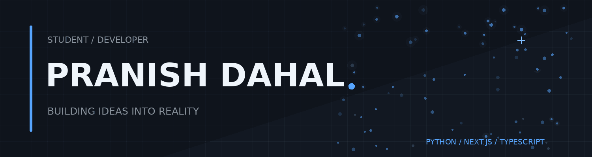

# 👋 Hey, I'm Pranish Dahal

  

<h3 align="center">Student • Developer • Tech Enthusiast</h3>

  Building ideas into reality through code and creativity.

---

## 👨‍💻 About Me

- 🎓 Student passionate about technology and development
- 💻 Interested in web development and programming
- 🚀 Exploring new technologies and building projects
- 🌱 Always learning and improving my skills

---

## 🛠️ Tech Stack

  

---

## 📊 GitHub Statistics

  
  

  

---

## 📫 Connect With Me

  
  

---

  <i>"Code. Create. Learn. Repeat."</i>

